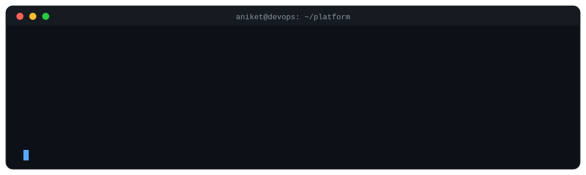
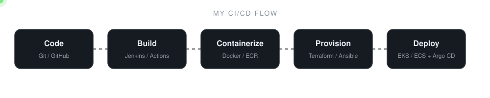

  

## Hi 👋, I'm Aniket Chatur

I'm an IT infrastructure professional with **10 years of experience** in infrastructure support, system administration, troubleshooting and operations, now focusing on DevOps, cloud engineering, automation and platform reliability.

- 🔭 Building hands-on DevOps and cloud infrastructure projects
- 🌱 Learning Kubernetes, AWS, Terraform, Ansible, Helm and GitOps
- ☁️ Exploring AWS infrastructure, Infrastructure as Code and CI/CD automation
- 🚀 Practicing production-style deployments, monitoring and reliability engineering
- 📍 India

  

## 🛠️ Languages and Tools

  

| Area | Tools |
| --- | --- |
| **Cloud** | AWS, Azure |
| **Containers and Orchestration** | Docker, Kubernetes |
| **Infrastructure as Code** | Terraform, Ansible |
| **CI/CD and GitOps** | Jenkins, GitHub Actions, Helm, Argo CD |
| **Monitoring** | Prometheus, Grafana |
| **Operating Systems and Scripting** | Linux, Bash |
| **Version Control** | Git, GitHub |

## 🔄 How I Ship

  

## 🚀 Featured DevOps Projects

| Project | What it covers |
| --- | --- |
| ☁️ [AWS EC2 Instance Deployment](https://github.com/chaturaniket7793-beep/AWS-EC2-instance) | Hosting an application on AWS EC2 instances |
| ⚙️ [Ansible Hands-on Project](https://github.com/chaturaniket7793-beep/Ansible-Hands-on-Project) | Configuration management and automation with Ansible playbooks |
| 🔵🟢 [Kubernetes Blue-Green Deployment](https://github.com/chaturaniket7793-beep/Blue-Green-Deployment-Strategy-k8s) | Blue-green release strategy and traffic switching in Kubernetes |
| ☸️ [Kubernetes GitOps Platform (2026)](https://github.com/chaturaniket7793-beep/Capstone-k8s-gitops-platform-2026) | Kubernetes platform with GitOps for application deployment |
| 🏗️ [Infrastructure as Code CI/CD Pipeline](https://github.com/chaturaniket7793-beep/Capstone-Project-3-Infra-as-code-pipeline-) | AWS ECS deployment with Terraform and GitHub Actions |
| 🔄 [Jenkins and GitHub Actions CI/CD Pipeline](https://github.com/chaturaniket7793-beep/Ci-Cd-Pipeline-jenkins--Project-2026) | Java application deployment to Amazon ECR with Jenkins and GitHub Actions |

## 📚 Current Learning Goals

- AWS cloud infrastructure and security
- Kubernetes administration and troubleshooting
- Terraform modules and remote state
- Ansible playbooks and configuration management
- CI/CD pipelines and GitOps
- Prometheus and Grafana observability

## 🤝 Connect With Me

- 💻 GitHub: [@chaturaniket7793-beep](https://github.com/chaturaniket7793-beep)
- 💼 LinkedIn: [Aniket Chatur](https://www.linkedin.com/in/aniket-chatur-a57966268/)

⭐ Thanks for visiting my profile! I'm continuously learning and building hands-on DevOps projects.

